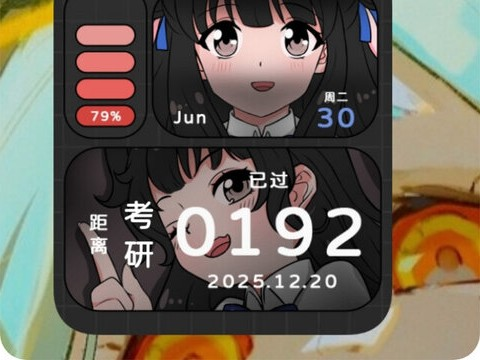
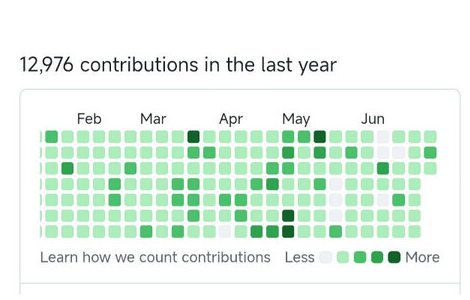
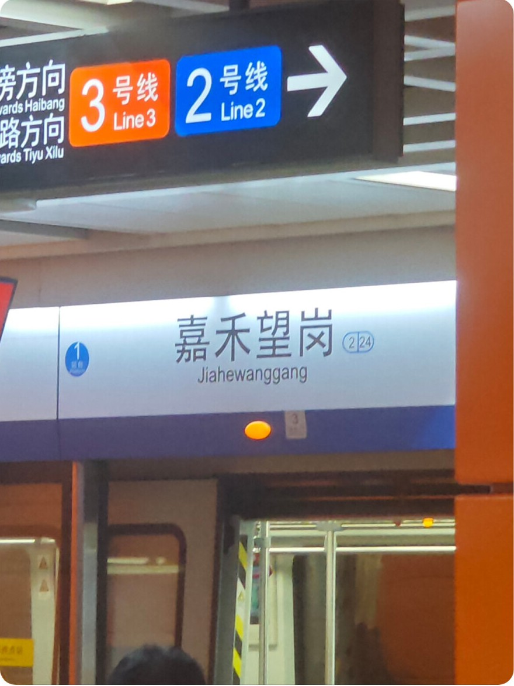

昨天是我生日，认识我的人都知道，我一般只会在特殊节点发总结性的文字，不过生日很罕见的没有发。

一个是因为我昨天下午太累了，睡着了，睡醒已经 30 号了，第二个是我感觉我似乎还没有完全是缓冲好写出这些文字。

上次写这些总结是在去年的年底，考研刚刚结束，跨年夜我一边在自己房间哭一边敲下了上一段总结。

时间过得好快，又半年过去了。

记得那时候一天天看着手机桌面添加的小组件 距离考研时间 这个时间从慢慢减少变成慢慢增多，现在时间都来到了 192 天了。

回到正题，我虽然似乎没有做好写这些文字的准备，但是确实从时间点来说，很微妙，我大学毕业了，昨天是我的生日，我明天即将开始我第一天的正式上班（非实习）也要开始真正的 landing 了。

所以我还是得写点什么去做一个收尾。

考研结束之后，立刻马不停蹄的开始了投递和学习，准备项目，我的 github 默默记录着这一切的努力。

前段时间叫 AI 帮我去邮箱看了看投递的情况，我大概是面试了有接近 80 场，笔试应该是有十余场，最后收获的 offer 还只有一家，而且从 timeline 来说也颇为坎坷，最终去上班的 offer 一月份就拿到了，后续先后面到终面的有 5 家，但是最后都没拿到 offer。

也出现过好几次口头挂或者审批挂各种原因乃至发了 offer 给我拖挂的情况，我最后已经麻木了，没什么感觉了，刷那么久互联网，似乎也没有比我更惨的（临时被毁约的除外）。

不过我感觉这一路上还是收获了很多的，一个是我更加确信我对做一个 builder 去创造属于自己的东西是真的有热情，甚至可以说是超乎常人的热情，第二个是这些历练也让我知道，至少目前来说我是不差的，我顶着很多 debuff[^1]，依然能拿到很多 top 公司，初创，独角兽的机会和认可，即使最后没有结果，我对自己也满意了，因为我过去会对自己不自信，我时常很疑惑就是我真的差到啥都找不着吗，现在看来不是。

第三个好事是，我过去很讨厌/排斥去北京工作有两大理由，一个是北京对我来说简直是美食荒漠，第二个是我有比较严重的慢性荨麻疹，到了北京不是很舒服，不过现在很惊讶的发现，我的荨麻疹似乎消失了，不知道是不是我压力值已经来到了 2147483647 导致压力消失了，还是什么原因。

当然，荨麻疹消失这种事情可能也不应该立 flag，说不定哪天又回来了。

但我确实感觉，这半年我的很多东西也在慢慢脱敏。

对拒绝脱敏，对不确定性脱敏，对"明明很努力但还是没有结果"脱敏，对很多说不清楚的期待和落空脱敏。

以前我很害怕自己是不是真的不行，害怕自己只是看起来努力，害怕自己最终什么都抓不住。现在好像没有那么怕了。因为这半年我已经把能做的事情做了一遍：投递、学习、准备项目、面试、复盘，然后继续投递、继续面试、继续复盘。

结果当然说不上漂亮，但至少我可以很确定地说，我没有糊弄过去。我是真的很用力地活过这半年，甚至我觉得回看来说，有点用力过头了，未来要给自己松松绑。

我不认可工作和金钱是我的一切，我觉得，只要我把这些当成附属品，那么它们终究有一天会流向我。

大学也就这样结束了。

它和我想象里的大学生活不太一样，甚至很多时候，我都觉得自己的大学生活和"大学"这两个字没有太大关系。我很早就搬出去住，很多时间都是一个人在房间里学习、写代码、焦虑、崩溃、恢复，然后继续写代码。好像没有什么特别完整的青春叙事，也没有什么很标准的毕业季结尾。

但回头看，我还是在这几年里变成了现在的我。

明天我就要开始第一天正式上班了。某种意义上，我也终于要从一直悬空的状态里落到地面上了。

我不知道接下来会怎么样，也不知道北京会不会真的适合我，不知道第一份正式工作会不会顺利，不知道我热爱的东西最后会把我带到哪里。

但是生日快乐，毕业快乐，也祝我正式开始人生下一个阶段快乐。

顺带预告一下，最近 build 的一个新项目，准备发了，一个以我名字命名的开源 coding agent。

希望之后还有精力能维护一个高质量的开源项目，给社区无论是谁带来一些价值。

也希望能持续的更新小红书。

对了，敲下这句话的时候，我已经到嘉禾望岗了。

[^1]: 指学历低
